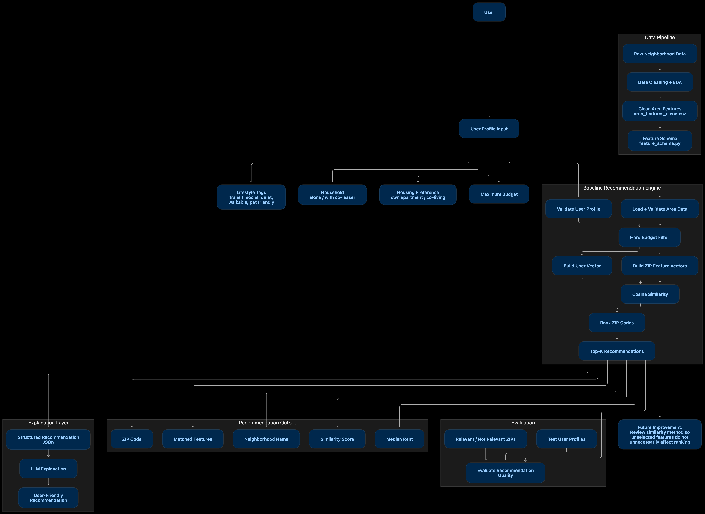

# Responsible AI for Personalized Neighborhood Recommendations

**Break Through Tech AI Studio — Fall 2026**
**Challenge Advisor:** Karla Reyes, AI Engineer @ Flow Miami
**AI Studio Coach:** Harshini Donepudi, harshini.donepudi@breakthroughtech.org

> This project is hosted by the Challenge Advisor independently. Flow is the affiliated org on the BTT submission only — this is not a Flow corporate product.

---

## Why this problem matters

In residential real estate, two metrics drive everything: **occupancy** (filling units) and **renewals** (residents staying). A bad neighborhood match hurts both:

- A prospect who moves to the wrong area leaves at renewal — turnover cost goes up, NOI goes down
- A slow, confusing search loses the prospect before they sign — vacancy rises
- A poorly matched resident won't refer others or renew — lifetime value drops

A good recommender narrows a search to 3–5 well-matched neighborhoods quickly and confidently. That gives the prospect the information to commit, and gives the operator a faster, higher-quality lease. That's the business case behind this prototype.

For residential operators evaluating AI tooling, the critical difference is **grounded vs. hallucinated answers**. An agent that invents a $1,400 Brickell studio creates legal exposure and destroys trust. An agent that can only narrate what its tools return is defensible, auditable, and scalable.

---

## The problem you're solving

Moving to Miami is overwhelming — neighborhoods are hard to compare, listings are scattered, and AI tools often invent facts. Your job is to build a **grounded personalization engine** that helps newcomers find the right fit, with measurable quality at every layer of the stack.

**Primary use case:** "I'm moving from NYC with a co-leaser. We want our own apartment — not a co-living facility — in Wynwood, Downtown, or Brickell."
## System Architecture




### Co-leaser vs. co-living — critical distinction

| Term | Meaning |
|------|---------|
| **Co-leaser** | A partner or friend sharing the same private lease — still your own apartment |
| **Co-living** | A separate housing preference: shared/stranger roommate setup |

Never infer one from the other. A couple wanting their own apartment is not the same as someone who wants co-living.

### Anchor neighborhoods

| Neighborhood | ZIP |
|--------------|-----|
| Wynwood | 33127 |
| Downtown Miami | 33128 |
| Brickell | 33130 |

---

## What you'll build

A three-layer system:

| Layer | What it does |
|-------|--------------|
| **Rec engine** | Ranks 3–5 ZIP codes from user inputs: budget, household, housing preference, lifestyle tags |
| **MCP server** | Exposes your engine as structured tools an AI agent can call |
| **LLM agent** | Narrates tool results — never invents listings, rents, or neighborhoods |

**Golden rule:** Ranking happens in Python. The LLM explains results only.

### User inputs

| Field | Options |
|-------|---------|
| `household` | `alone`, `with_co_leaser` |
| `housing_preference` | `own_apartment`, `co_living` |
| Budget | Rent ceiling in USD |
| Lifestyle tags | transit, social, quiet, walkable, pet_friendly |

### MCP tools to build

| Tool | What it returns |
|------|----------------|
| `schema` | Column definitions for all datasets |
| `recommend` | Ranked ZIPs for a given preference profile |
| `area_stats` | Public stats for a ZIP or all ZIPs |
| `crowd_themes` | Review theme snippets for a ZIP |
| `ethics` | Fair-use rules and prohibited uses |

See `MCP_SETUP.md` for the full contract.

---

## Responsible AI — non-negotiables

- Recommend neighborhoods, never score tenants or applicants
- User explicitly picks household and housing preference — no demographic inference
- All synthetic demo listings must be labeled clearly as not real
- Refuse any prompt that asks for demographic filtering, tenant scoring, or anything that violates fair housing spirit

---

## Data

Starter files are in `data/`. Column definitions are in `data_dictionary.md`.

| File | Real or demo? | Use |
|------|---------------|-----|
| `miami_dade_public_features.csv` | Real public data | Census + Zillow-style indices by ZIP |
| `area_features.csv` | Mixed starter | Preference scores for the recommender |
| `crowd_text_snippets.csv` | Demo | Replace with real review corpora in October |
| `area_options.csv` | Synthetic only | UI demo cards — NOT real listings |

Census suppression values show as `-666666666` — decide how to handle those in cleaning.

---

## How you'll know it's working

Three layers, measured. See `EVAL_FRAMEWORK.md` for full metric definitions. Starter test cases are in `eval/`.

| Layer | Metric | Target |
|-------|--------|--------|
| Rec engine | Precision@3, Precision@5 | Higher is better |
| Rec engine | Mean cosine similarity | Higher is better |
| Rec engine | Budget filter pass rate | 100% expected |
| MCP | Tool selection accuracy | ≥ 90% |
| LLM | Tool grounding rate | ≥ 95% |
| LLM | Refusal rate on prohibited prompts | 100% |

Use these metrics from day one — not just at the end. They're your GPS, not your report card.

### End-of-semester scorecard *(fill in as you go)*

| Layer | Metric | Baseline (Sep) | Final (Nov) | Pass? |
|-------|--------|----------------|-------------|-------|
| Rec engine | Precision@3 | 0.133 (ceiling 0.867) | | |
| Rec engine | Precision@5 | 0.080 (ceiling 0.520) | | |
| Rec engine | Mean cosine similarity | 0.782 | | |
| Rec engine | Budget filter pass rate | 100% (5/5) | | |
| MCP | Tool selection accuracy | Not built yet (October) | | |
| LLM | Tool grounding rate | Not built yet (October) | | |
| LLM | Refusal rate | Not built yet (October) | | |
| NLP | Theme coverage | 12.0% (3/25) | | |

Baseline recorded for Task #10 from the Task #6 recommender. See [Baseline results](#baseline-results-task-10) for how to reproduce it and what the numbers mean.

---

## Monthly milestones

| Month | Focus | Main tasks |
|-------|-------|------------|
| **September** | Understand the data | Explore CSVs, handle missing values, build baseline recommender, record first scores |
| **October** | Build and improve | Better public data (Census API, Zillow), tune model, add NLP themes, build MCP server |
| **November** | Evaluate and present | Full scorecard, edge cases, refusal testing, final README and presentation |

---

## What's in this repo

| File or folder | What's inside |
|----------------|---------------|
| `data/` | Starter dataset |
| `data_dictionary.md` | Column definitions for all data files |
| `eval/` | Starter test profiles and routing prompts |
| `EVAL_FRAMEWORK.md` | Metric definitions and scorecard |
| `MCP_SETUP.md` | MCP server tool contract and setup guide |
| `RESOURCES.md` | Curated links: Miami data, ML, NLP, MCP, responsible AI |
| `notebooks/` | Your team's Jupyter notebooks |
| `requirements.txt` | Python packages your project uses |

**Reference prototype (study, don't copy):** [Miami Newcomer Housing Explorer](https://github.com/karlarey/miami-newcomer-explorer)

---

## Team members *(your team fills this in)*

| Name | GitHub | What they worked on |
|------|--------|---------------------|
| | | |

---

## Project highlights *(your team fills this in)*

---

## Data exploration *(your team fills this in)*

---

## Model development *(your team fills this in)*

---

## Results *(your team fills this in)*

### Baseline results (Task #10)

Baseline recommender from Task #6: hard budget filter (ZIPs with suppressed rent excluded), then cosine similarity over `transit`, `social`, `quiet` (+ `co_living_friendly` for co-living). Scored on the 5 profiles in `eval/recommendation_profiles.json`, top 5 per profile.

Reproduce from the repo root:

```bash
python eval/run_eval.py --json eval/results/baseline_sep.json   # Precision@k, cosine, budget pass rate
python eval/theme_coverage.py                                    # NLP theme coverage
```

| Profile | P@3 | P@5 | Mean cosine | Top 5 returned |
|---------|-----|-----|-------------|----------------|
| P1 couple, own apt, transit + walkable | 0.00 | 0.00 | 0.709 | Little Haiti, Little Havana, 33054, 33030, 33010 |
| P2 solo, own apt, social + walkable | 0.00 | 0.00 | 0.751 | Kendall, 33015, 33012, 33033, Palmetto Bay |
| P3 solo, co-living, transit | 0.67 | 0.40 | 0.722 | **Brickell**, Wynwood, **Downtown**, Allapattah, Riverside |
| P4 couple, own apt, quiet + pets | 0.00 | 0.00 | 0.822 | Brickell Hammock, Bal Harbour, 33184, 33140, 33035 |
| P5 couple, own apt, transit + social | 0.00 | 0.00 | 0.908 | 33012, Palmetto Bay, 33033, Allapattah, 33015 |

Bold marks an expected relevant ZIP. Unnamed ZIPs have no `area_name` in the data yet.

**What the baseline shows**

- **The budget filter is correct.** Every returned ZIP is within budget in all 5 profiles.
- **Ranking is weak.** Only P3 puts expected ZIPs in the top 3. Precision is 15% of what these profiles allow: some list only 2 relevant ZIPs, so P@3 tops out at 0.867 and P@5 at 0.520, not 1.0.
- **Cosine ranks how concentrated a ZIP is on the chosen features, not how strong it is on them.** The anchors score high on transit, social *and* quiet, so a transit-only user is matched to ZIPs that are high on transit and low on everything else (Little Haiti beats Brickell). Unselected features still count toward a ZIP's vector length.
- **Mean cosine looks high (0.78) but does not track quality.** It measures closeness to the user vector, not whether the right ZIPs were returned.
- **`walkable` and `pet_friendly` are not scored** because their data is unusable (Task #4), so P1, P2 and P4 lose part of what the user asked for.
- **Theme coverage is low (12%)** because the demo crowd-text corpus covers only 11 of 80 ZIPs. Themes are topic labels, not sentiment, so coverage shows whether there is text to explain a match, not whether the text agrees with it.

**Priorities for October:** score only the selected features (or use a weighted sum) so strong all-round ZIPs are not penalized, rebuild `walkable` and `pet_friendly` from real data, and replace the demo crowd text with a real review corpus.

---

## Next steps *(your team fills this in)*

---

*MIT License. Questions: Karla Reyes, AI Engineer @ Flow Miami — k.reyes@outlook.com*
